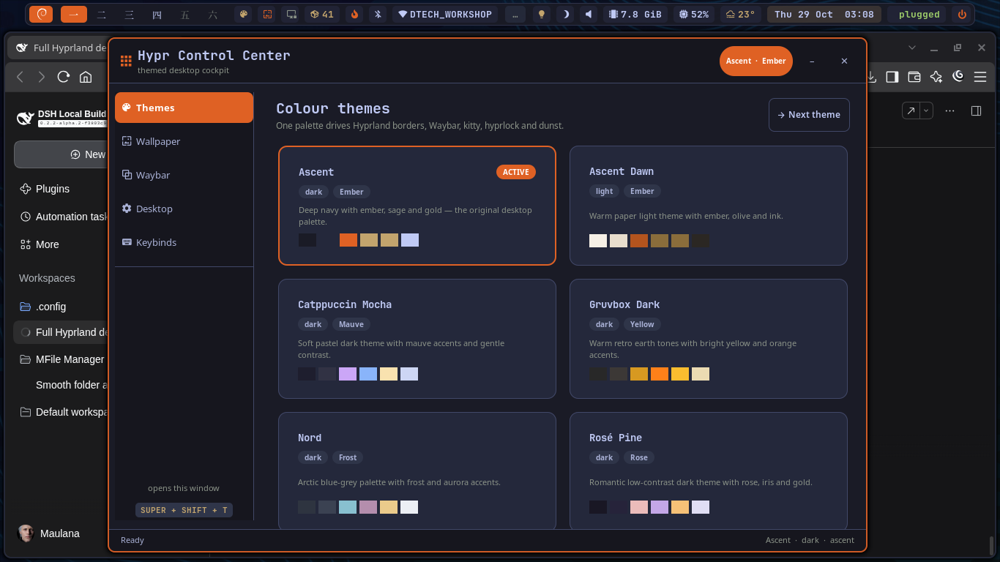
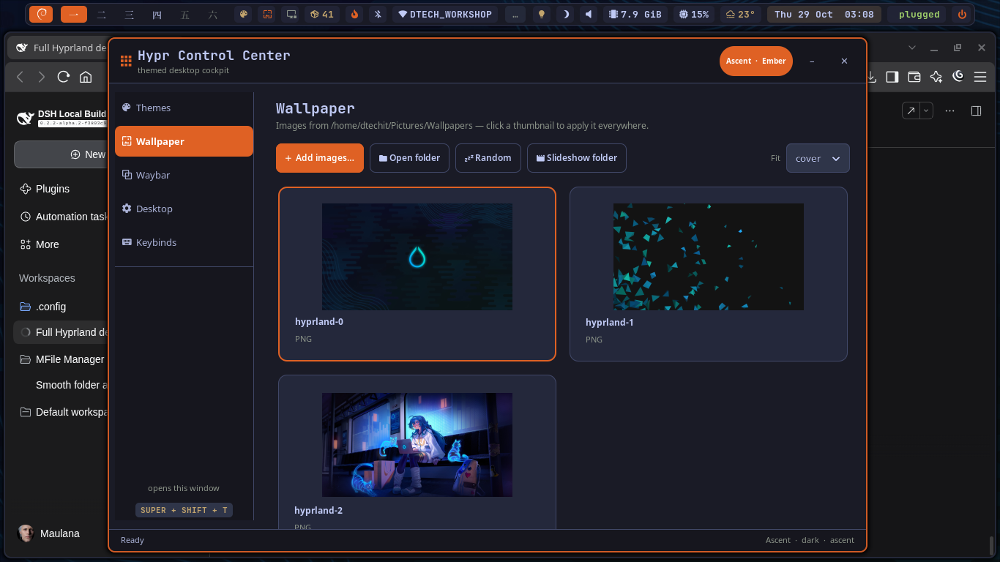
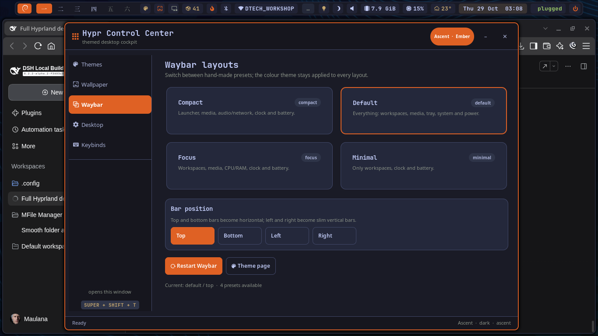
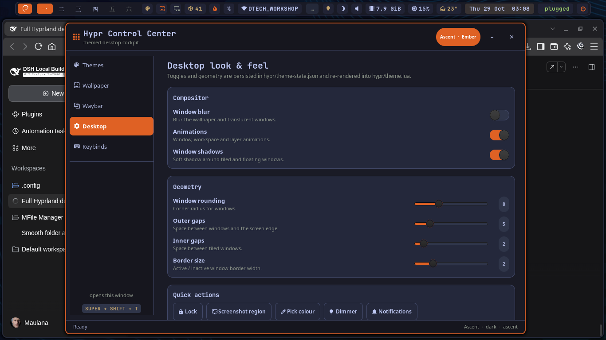
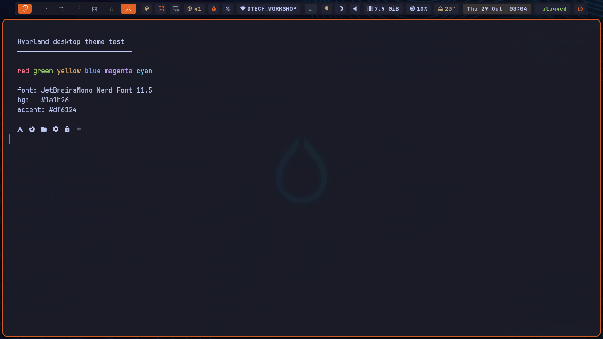

# Ascent — a full Hyprland desktop

One palette for **Hyprland, Waybar, kitty, hyprlock, dunst and hyprpaper** — plus a GTK control
centre for switching themes, wallpapers, Waybar layouts and compositor toggles.



## What is in here

| Piece | What it does |
| --- | --- |
| **Ascent theme engine** | `hypr/scripts/theme-switch` renders one TOML palette into every app. |
| **6 palettes** | Ascent (default), Ascent Dawn (light), Catppuccin Mocha, Gruvbox Dark, Nord, Rosé Pine. |
| **Hypr Control Center** | GTK3 cockpit: theme cards, wallpaper thumbnails, Waybar presets, compositor toggles, keybind cheat sheet. |
| **hyprpaper + picker** | Wallpaper changing with a GUI, directory slideshows, fit modes, random wallpaper. |
| **Clickable Waybar** | Workspaces activate on left-click, close on right-click; theme/wallpaper buttons; 4 layout presets; 4 bar positions. |
| **Themed kitty** | Fonts, padding, opacity, blur, powerline tabs, 16-colour terminal palette. |
| **Themed hyprlock** | Wallpaper background, blurred clock/date, themed password field, user@host footer. |
| **Themed dunst** | Notifications that follow the same palette (and now actually autostart). |
| **Dotfiles repo** | Git allowlist that tracks only the Hypr ecosystem. |



## Quick start

```bash
# 1. Put this repo at ~/.config (or copy the allow-listed directories)
git clone <your-repo-url> ~/.config

# 2. Install fonts, local extras and render the theme
~/.config/hypr/scripts/bootstrap

# 3. Open the cockpit
~/.config/hypr/scripts/hypr-control-center
```

`bootstrap` is safe to re-run. It installs the Nerd Fonts, checks dependencies, installs
`hyprpaper`/`hyprpicker` into `~/.local/bin` when it can (no sudo), copies the default wallpaper,
renders every theme file, and starts Waybar / dunst / hyprpaper if they are not running.

### Dependencies

Hyprland 0.55+ with the Lua config provider, plus:

`waybar` · `kitty` · `hyprlock` · `hypridle` · `hyprlauncher` · `hyprshutdown` · `hyprsunset` ·
`hyprpolkitagent` · `dunst` · `grim` · `slurp` · `wl-clipboard` · `cliphist` · `brightnessctl` ·
`playerctl` · `btop` · ImageMagick · Python 3.11+ with PyGObject (GTK 3) · `hyprpaper` ·
`hyprpicker` · JetBrainsMono Nerd Font · Symbols Nerd Font.

On Debian:

```bash
sudo apt install hyprland waybar kitty hyprlock hypridle dunst hyprlauncher hyprshutdown \
  hyprsunset hyprpolkitagent grim slurp wl-clipboard cliphist brightnessctl playerctl \
  imagemagick python3-gi hyprpaper hyprpicker
```

`wttrbar` is bundled in `waybar/wttrbar`, so the weather module works without a network install.

## Themes

```bash
theme-switch list              # list palettes
theme-switch set nord          # apply Nord everywhere
theme-switch next              # cycle (also SUPER+ALT+T)
theme-switch prev
theme-switch apply             # re-render files from the current state
theme-switch option blur on    # persist a look-and-feel toggle
theme-switch option rounding 12
theme-switch option animations off
```

The palette lives in `hypr/themes/<slug>.toml`:

```toml
name = "My Theme"
description = "What it feels like."
variant = "dark"
accent_name = "Cyan"

[colors]
bg = "#101418"
surface = "#182028"
fg = "#d8e2ea"
accent = "#4fd1c5"
# … see an existing theme for the full colour list

[terminal]
"0" = "#101418"
# … 16 terminal colours
```

Then `theme-switch set my-theme`. A theme change updates:

- `hypr/theme.lua` — borders, shadow, blur, gaps, rounding, animations
- `waybar/colors.css` — imported by `waybar/style.css`
- `kitty/theme.conf` — included by `kitty/kitty.conf`
- `hypr/hyprlock.conf` — generated from `hypr/templates/hyprlock.conf.in`
- `hypr/hyprpaper.conf` — generated from `hypr/templates/hyprpaper.conf.in`
- `dunst/dunstrc` — generated from `hypr/templates/dunstrc.in`

Waybar reloads with `SIGUSR2`, kitty with `SIGUSR1`, dunst with `dunstctl reload`, and Hyprland with
`hyprctl reload`. The Control Center polls the state file, so it updates live if you change a theme
from the bar or CLI.

## Wallpaper

```bash
wallpaper-set ~/Pictures/Wallpapers/foo.png
wallpaper-set --random
wallpaper-set --fit contain ~/Pictures/Wallpapers/foo.png
wallpaper-set --directory ~/Pictures/Wallpapers   # 5-minute random slideshow
wallpaper-set --list
```

The Control Center can add images (multi-select), open the folder, pick a random image, start a
slideshow and choose `cover` / `contain` / `fill` / `tile`. Images you add through the GUI are copied
to `~/Pictures/Wallpapers`.

The lock screen automatically uses the current wallpaper too.

> **hyprpaper note:** this repo was built against hyprpaper 0.8.4, whose IPC has a segfault when a
> config with a `wallpaper` block receives a runtime wallpaper change. `wallpaper-set` therefore
> writes the generated config and restarts hyprpaper instead of using IPC. JPEGs are converted to a
> cached 8-bit PNG first, which is also friendlier to that build.

## Waybar

- **Workspaces:** left-click **activates** a workspace, right-click **closes** it. `move-to-monitor`
  is on, so clicking a workspace opens it on the current monitor.
- **Theme button:** click to open the Control Center, scroll to cycle themes.
- **Wallpaper button:** click to open the picker, right-click for a random wallpaper.
- **Power button:** opens `hyprshutdown`.
- **Updates:** `waybar/scripts/updates.sh` counts Debian package upgrades every hour.

Switch layouts and positions:

```bash
waybar-mode --layout default --position top
waybar-mode --layout compact --position bottom
waybar-mode --layout minimal --position top
waybar-mode --layout focus --position top
waybar-mode --position left      # slim vertical bar
waybar-mode --list
```

Presets live in `waybar/presets/`; shared module definitions are in `_modules.json`. When you change
a preset, the engine writes the merged result to `waybar/config.jsonc` and restarts Waybar.



## Hypr Control Center

```bash
hypr-control-center --tab theme
hypr-control-center --tab wallpaper
hypr-control-center --tab bar
hypr-control-center --tab desktop
hypr-control-center --tab keys
```

It is a single GTK application: launching it again with another `--tab` switches the existing
window instead of opening duplicates. The window floats, centres itself through Hyprland, and is
matched by a window rule on the `land.hypr.ControlCenter` class.

The **Desktop** tab persists `blur`, `animations`, `shadow`, `rounding`, `gaps_in`, `gaps_out` and
`border_size` in `hypr/theme-state.json`, then re-renders `hypr/theme.lua` and reloads Hyprland.
It also has quick actions for lock, region screenshot, colour picking, the Hyprsunset dimmer and
notification pause.



## Keybinds

| Keys | Action |
| --- | --- |
| `SUPER + Return` | kitty |
| `SUPER + E` | Dolphin |
| `SUPER + R` | Hyprlauncher |
| `SUPER + L` | Lock screen |
| `SUPER + SHIFT + T` | Control Center — themes |
| `SUPER + SHIFT + W` | Control Center — wallpaper |
| `SUPER + ALT + T` | Next colour theme |
| `SUPER + ALT + B` | Control Center — Waybar layouts |
| `SUPER + SHIFT + P` | Pick a colour to clipboard (hyprpicker) |
| `SUPER + SHIFT + S` | Region screenshot → clipboard |
| `Print` | Region screenshot → swappy |
| `SUPER + Print` | Region screenshot → clipboard |
| `SUPER + SHIFT + V` | Clipboard history (cliphist + hyprlauncher) |
| `SUPER + SHIFT + N` | Pause/resume notifications |
| `SUPER + SHIFT + R` | Reload Hyprland |
| `SUPER + 1…0` | Switch workspace |
| `SUPER + SHIFT + 1…0` | Move window to workspace |
| `SUPER + S` | Scratchpad workspace |
| `SUPER + F` / `SUPER + M` | Fullscreen / maximise |
| `SUPER + V` | Toggle floating |
| `SUPER + drag` / `SUPER + right-drag` | Move / resize a window |
| Media & brightness keys | Volume, mic mute, brightness, Hyprsunset, playerctl |

## Themed terminal

`kitty/kitty.conf` is intentionally small and readable: JetBrainsMono Nerd Font, 95% opacity with
background blur, powerline tabs, and a 10k-line scrollback. Colours are imported last from
`kitty/theme.conf`.



## Repository layout

```text
~/.config/
├── .gitignore                 # allowlist: only the Hypr ecosystem
├── README.md
├── hypr/
│   ├── hyprland.lua           # main config, keybinds, autostart, rules
│   ├── hypridle.conf
│   ├── hyprlock.conf          # generated
│   ├── hyprpaper.conf         # generated
│   ├── theme.lua              # generated
│   ├── theme-state.json       # current theme/wallpaper/options
│   ├── themes/*.toml
│   ├── templates/*.in
│   ├── scripts/
│   │   ├── theme_engine.py
│   │   ├── theme-switch
│   │   ├── wallpaper-set
│   │   ├── waybar-mode
│   │   ├── hypr-control-center
│   │   └── bootstrap
│   └── assets/                # screenshots + default wallpaper
├── waybar/
│   ├── config.jsonc           # generated from presets
│   ├── colors.css             # generated
│   ├── style.css
│   ├── presets/{_modules,default,compact,minimal,focus}.json
│   ├── scripts/{updates.sh,hyprsunset-slider.py}
│   └── wttrbar
├── kitty/
│   ├── kitty.conf
│   └── theme.conf             # generated
└── dunst/
    └── dunstrc                # generated
```

## Git policy

The repo lives at `~/.config`, but `.gitignore` ignores **everything** and then un-ignores only:

```
hypr/  waybar/  kitty/  dunst/  README.md  .gitignore
```

That means KDE, Code, Brave, gh tokens, session data, caches and every other app config stay out of
Git. Run `git status` to see the clean allowlist in action.

Generated files are tracked on purpose so a clone is immediately usable; changing a theme will show
a tidy diff of the generated palette files. Commit after a theme change if you want to pin it.

## Troubleshooting

**Missing icons / boxes.** Install the Nerd Fonts (`bootstrap` does this) and run `fc-cache -f`.
Waybar and kitty both ask for `JetBrainsMono Nerd Font` first, then `Symbols Nerd Font`.

**Wallpaper does not change.** Check `pgrep -x hyprpaper` and
`hyprctl hyprpaper listactive`. Run `wallpaper-set ~/Pictures/Wallpapers/hyprland-0.png` to force a
known-good PNG. If hyprpaper is missing, `bootstrap` installs it locally or use
`sudo apt install hyprpaper`.

**Lock screen client crashed.** `misc:allow_session_lock_restore` is enabled in
`hypr/hyprland.lua`, so you can start hyprlock again with `SUPER + L` (or
`hyprctl dispatch 'hl.dsp.exec_cmd("hyprlock")'`).

**Waybar CSS import.** `style.css` starts with `@import url("colors.css");`. If you copy just
`style.css` somewhere else, copy `colors.css` too or re-run `theme-switch apply`.

**Hyprland version.** The config uses Hyprland's Lua provider (`hyprland.lua` + `require`). On older
versions convert back to `hyprland.conf` or update Hyprland.

## Credits

Built on [Hyprland](https://hypr.land), [Waybar](https://github.com/Alexays/Waybar),
[kitty](https://sw.kovidgoyal.net/kitty/), [hyprpaper](https://github.com/hyprwm/hyprpaper),
[hyprlock](https://github.com/hyprwm/hyprlock), [dunst](https://dunst-project.org/) and
[Nerd Fonts](https://www.nerdfonts.com/). Palettes inspired by Catppuccin, Gruvbox, Nord and
Rosé Pine; **Ascent** is the original ember/sage/gold palette from this desktop.
