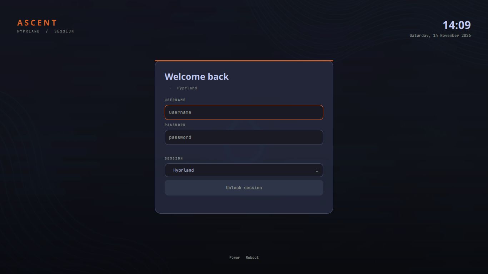

# Ascent — a full Hyprland desktop

Hyprland desktop configuration for Waybar, kitty, hyprlock, dunst, hyprpaper, and Hyprlauncher. A shared theme engine applies palettes across the desktop; the GTK Control Center manages themes, wallpapers, and layout options.


## Install

Clone this repository to `~/.config`, then run the bootstrap script:

```bash
git clone <repo-url> ~/.config
~/.config/hypr/scripts/bootstrap
~/.config/hypr/scripts/hypr-control-center
```

Requires Hyprland 0.55+ with the Lua config provider, Python 3.11+ with PyGObject, Nerd Fonts, and the desktop tools used by the configuration: Waybar, kitty, hyprlock, hypridle, hyprlauncher, hyprshutdown, hyprsunset, hyprpolkitagent, dunst, grim, slurp, wl-clipboard, cliphist, brightnessctl, playerctl, btop, cava, ImageMagick, hyprpaper, and hyprpicker. Bootstrap checks dependencies and installs local extras when possible.

On Debian, install the system packages with:

```bash
sudo apt install hyprland waybar kitty hyprlock hypridle hyprlauncher hyprshutdown \
  hyprsunset hyprpolkitagent dunst grim slurp wl-clipboard cliphist brightnessctl \
  playerctl btop cava imagemagick python3-gi hyprpaper hyprpicker
```

## Commands

Put the helper commands in `~/.local/bin` once:

```bash
~/.config/hypr/scripts/install-cli
```

After that, these short commands work:

```bash
theme-switch list
theme-switch set nord
theme-switch next
theme-switch apply
theme-switch option blur on

wallpaper-set ~/Pictures/Wallpapers/image.png
wallpaper-set --random
wallpaper-set --directory ~/Pictures/Wallpapers

waybar-mode --layout compact --position bottom
waybar-mode --list

hypr-control-center --tab theme
```

The Control Center also has wallpaper, bar, desktop, and keybind tabs. `SUPER + SHIFT + T` opens it; `SUPER + ALT + T` changes the theme.

## Login

This machine currently boots to `tty1`; there is no display manager installed. The `sddm`
package is removed (`rc`), `/usr/bin/sddm` does not exist, and the old `sddm.service` init
script is just a no-op. Login is a normal getty/bash login, then `start-hyprland` is run
manually.

### Auto-login straight into Hyprland (no display manager)

The simplest setup is to keep the TTY and skip a display manager entirely:

```bash
sudo ~/.config/hypr/scripts/setup-autologin
sudo reboot
```

That script writes a `getty@tty1` autologin drop-in and adds a marked block to
`~/.bash_profile` that execs `/usr/bin/start-hyprland` on tty1. To undo it, remove
`/etc/systemd/system/getty@tty1.service.d/autologin.conf`, run `systemctl daemon-reload`,
and delete the `>>> hypr-autologin >>>` block from `~/.bash_profile`.

### Themed SDDM (graphical greeter + auto-login)

If you want a graphical login manager, install SDDM and the tracked Ascent theme:

```bash
sudo apt update
sudo apt install sddm qml6-module-qtquick-controls qml6-module-qtquick-window
sudo ~/.config/hypr/scripts/install-sddm
sudo reboot
```

`install-sddm`:

- copies the QML theme from `hypr/sddm/themes/ascent/` to `/usr/share/sddm/themes/ascent/`
- copies the current wallpaper as the theme background
- writes `/etc/sddm.conf.d/10-autologin.conf` for `Session=hyprland`
- writes `/etc/sddm.conf.d/20-theme.conf`
- writes `/etc/sddm.conf.d/30-input-method.conf` with `InputMethod=` empty, disabling SDDM's
  default full-screen Qt virtual keyboard
- removes the tty autologin path
- enables SDDM; it does **not** restart it, so the current session stays alive

The greeter is visible on logout; auto-login still takes you straight to Hyprland.
Theme colors live in the generated `theme.conf`/`theme.js`; rerun
`theme-switch apply` and `install-sddm` after changing themes or wallpaper.

The QML entry point is `hypr/sddm/themes/ascent/Main.qml` and is linted with Qt 6
`qmllint`. The theme needs the Qt Quick Controls/Window QML modules above.



## Session environment

`hyprland.lua` exports the complete session environment to D-Bus and systemd at startup
(`dbus-update-activation-environment --systemd --all` plus an explicit
`systemctl --user import-environment`). This matters for X11/XWayland apps launched through
portals, desktop files or systemd: they need `DISPLAY`, `WAYLAND_DISPLAY`,
`HYPRLAND_INSTANCE_SIGNATURE`, `XDG_SESSION_TYPE` and `XDG_CURRENT_DESKTOP`.

X11 apps do not have Hyprland workspaces themselves. They map a window to the active
workspace when the window is created. Long-running tray apps keep opening new windows on
the workspace where their process first mapped; use a window rule to pin those to a fixed
workspace, or start them after switching to the workspace you want.

## Customize

- Themes: `hypr/themes/*.toml`
- Templates: `hypr/templates/`
- Waybar layouts: `waybar/presets/`
- Wallpapers: `~/Pictures/Wallpapers/`

Run `theme-switch apply` to regenerate the app palettes from the current theme. Generated configuration files are tracked so a fresh clone works immediately.

Machine-local customization state lives in `hypr/theme-state.local.json` and `waybar/cava-state.json`; both are gitignored. Paths are written with `~/` so generated configs stay portable. Delete the local state to fall back to the defaults in [theme_engine.py](hypr/scripts/theme_engine.py).

## Repository

This repository lives at `~/.config`. `.gitignore` allows only `hypr/`, `waybar/`, `kitty/`, `dunst/`, `README.md`, and `.gitignore`; other desktop and application data stays out of Git. Check `git status` before committing.

Waybar logs are in `~/.cache/waybar.log`; the IPC shim log is `~/.cache/waybar-ipc-proxy.log`. Start Waybar through `~/.config/waybar/scripts/start-waybar` so workspace actions use the Hyprland IPC shim.

The shim also mirrors the real instance's `.hyprpaper.sock`, `.hyprsunset.sock` and event socket into the proxy directory (and refreshes them every couple of seconds). That is what allows tools launched from Waybar — the Hyprsunset slider, scroll-to-adjust gamma, and the wallpaper picker — to talk to hyprsunset/hyprpaper while Waybar is using the proxy signature.

Do not enable `waybar.service`: it starts a second bare Waybar without the IPC shim. This setup starts Waybar only from `hyprland.lua` via `start-waybar`; the user service is masked and its original file is kept as `~/.config/systemd/user/waybar.service.disabled`.
